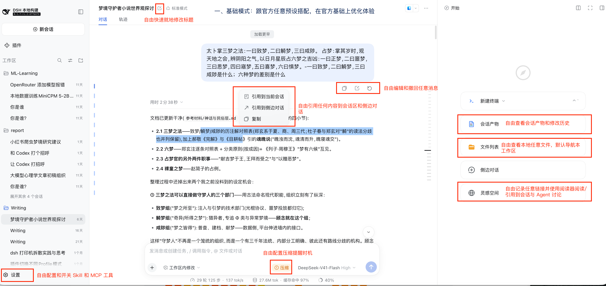
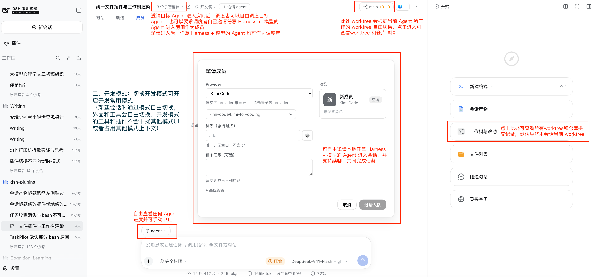

# dsh-plugins

English | [中文](README.md)

The community plugin monorepo for the **dsh** (DeepSeek Harness) ecosystem: **thirty-plus purely additive plugin packages, organized into 5 suites**. Every package integrates through official extension points only — slots, commands, Remote services, session projections. No official package is modified, no official UI slot is replaced, no core service is hacked; when an optional capability is absent the plugin degrades silently instead of failing the boot. The whole set is designed for coexistence: install, uninstall, or toggle any combination without interference, and the production instance runs the full stack long-term.

## Suites: five ready-to-run experiences

The recommended install unit is a **suite** (one npm package), not a single plugin: a suite pulls in its members as npm dependencies and mounts their canonical rows through its own patch; every suite except the basic one also ships an inline agent preset granted per session. Install the suite, and you have installed the mode.

| Suite | Package | What you get | Front-door repo |
| --- | --- | --- | --- |
| **基础体验 (Essentials)** | `@khorsheed/dsh-basic` | 12 everyday members: message edit/withdraw, the history timeline, title editing, quote actions, artifact preview, local files, task capsules, the compaction reminder, inline cards, the capability catalog, the completion chime, and mobile | [Khorsheed/dsh-basic](https://github.com/Khorsheed/dsh-basic) |
| **开发套件 (Dev)** | `@khorsheed/dsh-dev-suite` | Local coding-agent delegation (Kimi / Codex / Claude Code / DSH), live worktree state, room multi-agent collaboration, typesafe quick judgement, the context lens and the ops guard — with the 开发模式 preset | [Khorsheed/dsh-dev](https://github.com/Khorsheed/dsh-dev) |
| **学习套件 (Learning)** | `@khorsheed/dsh-learning-suite` | The library: project-organized close reading (book ingestion, roadmaps, lecture notes, quizzes) with reader/transcribe/capture included — with the 学习模式 preset | [Khorsheed/dsh-learning](https://github.com/Khorsheed/dsh-learning) |
| **剪辑套件 (Video)** | `@khorsheed/dsh-video-suite` | The cutting room: multi-speaker mixdowns, voiceprint recognition, delete-the-word-deletes-the-audio, audio/video/subtitle/shownotes export; local transcription and multi-agent work (local-agent delegation, rooms) included — with the 剪辑模式 preset | [Khorsheed/dsh-video](https://github.com/Khorsheed/dsh-video) |
| **游戏开发套件 (Gamedev)** | `@khorsheed/dsh-gamedev-suite` | Build small games with the agent: playtest tuning, appearance editing, chaptered design docs, versions and rollback, end-of-turn checks, multi-agent work (local-agent delegation, rooms) — with the 游戏开发模式 preset | [Khorsheed/dsh-gamedev](https://github.com/Khorsheed/dsh-gamedev) |





## One-command install: collections

An ordinary user needs one **collection**: the basic suite plus one mode suite. A collection is just a list (`collections.json`), not an npm package — `dsh plugin add` takes several package names, so one command installs it. If you would rather pick, any single package or suite installs on its own and coexists with a collection without mounting anything twice.

<!-- collections:start -->
<!-- generated by pnpm map:collections from collections.json; do not edit by hand -->

| Collection | One command |
| --- | --- |
| Basic | `dsh plugin --profile web add @khorsheed/dsh-basic` |
| Dev | `dsh plugin --profile web add @khorsheed/dsh-basic @khorsheed/dsh-dev-suite` |
| Learning | `dsh plugin --profile web add @khorsheed/dsh-basic @khorsheed/dsh-learning-suite` |
| Video | `dsh plugin --profile web add @khorsheed/dsh-basic @khorsheed/dsh-video-suite` |
| Gamedev | `dsh plugin --profile web add @khorsheed/dsh-basic @khorsheed/dsh-gamedev-suite` |
| Everything | `dsh plugin --profile web add @khorsheed/dsh-basic @khorsheed/dsh-dev-suite @khorsheed/dsh-learning-suite @khorsheed/dsh-video-suite @khorsheed/dsh-gamedev-suite` |
<!-- collections:end -->

## Capability map

Each package's details, configuration and screenshots live in its own directory README (click through). The "install" column copies straight into the installer; the "suite" column says which suite brings it (members may overlap across suites); "solo" packages ship with no suite — install them through the Add-plugin dialog or `dsh plugin add`.

### Conversation control

| Package | What it does | Install | Host | Suite |
| --- | --- | --- | --- | --- |
| [`message-tools`](packages/client-message-tools) | **In-place edit / true withdraw / restore-replay** for user messages — the only plugin here that changes what the model sees, riding the same mechanism as the official compaction | `@khorsheed/dsh-client-message-tools` | ≥ 0.1.5-rc.1 | basic |
| [`message-timeline`](packages/message-timeline) | A floating **history timeline** on the chat's left edge — click to jump to any user message | `@khorsheed/dsh-message-timeline` | ≥ 0.1.2-rc.1 | basic |
| [`session-title-edit`](packages/client-session-title-edit) | **Inline session-title renaming**; a user-set title is never overwritten by auto-generation | `@khorsheed/dsh-client-session-title-edit` | ≥ 0.1.2-rc.1 | basic |
| [`quote`](packages/quote) | Select any text for a floating **quote action menu** (quote into the composer / copy); other plugins can register their own actions | `@khorsheed/dsh-quote` | ≥ 0.1.5-rc.1 | basic |

### Files and artifacts

| Package | What it does | Install | Host | Suite |
| --- | --- | --- | --- | --- |
| [`file-preview`](packages/file-preview) | The session **artifacts** tab + host service in one package: artifact list, per-turn change cards, a detail preview drawer, and the read-only file-preview Remote | `@khorsheed/dsh-file-preview` | ≥ 0.1.5-rc.1 | basic |
| [`local-files`](packages/local-files) | A right-sidebar **local file browser**: lazy tree + structured previews for HTML/Markdown/JSON/CSV/images | `@khorsheed/dsh-local-files` | ≥ 0.1.5-rc.1 | basic |

### Tasks and ambience

| Package | What it does | Install | Host | Suite |
| --- | --- | --- | --- | --- |
| [`taskpilot`](packages/taskpilot) | **Background-job / sub-agent capsules** above the composer: live timing, stop/interrupt, and a detail drawer replaying the run | `@khorsheed/dsh-taskpilot` | ≥ 0.1.5-rc.1 | basic |
| [`context-guard`](packages/context-guard) | A **one-click compact reminder** appears above the composer when context usage crosses your configured threshold | `@khorsheed/dsh-context-guard` | ≥ 0.1.2-rc.1 | basic |
| [`whalesong`](packages/whalesong) | Task ambience: a spouting whale, favicon animation, and completion/blocked chimes (`prefers-reduced-motion` mutes automatically) | `@khorsheed/dsh-whalesong` | ≥ 0.1.2-rc.1 | basic |

### Experience and efficiency

| Package | What it does | Install | Host | Suite |
| --- | --- | --- | --- | --- |
| [`inline-html-render`](packages/inline-html-render) | Renders ```` ```dsh-card ```` HTML blocks the agent writes into **sandboxed interactive cards** in the conversation | `@khorsheed/dsh-inline-html-render` | ≥ 0.1.2-rc.1 | basic |
| [`context-lens`](packages/context-lens) | **Context lens**: per-turn inspection of each model request — system-section attribution, tool definitions, history vs. new context, tokens and latency | `@khorsheed/dsh-context-lens` | ≥ 0.1.5-rc.1 | dev |
| [`mobile`](packages/mobile) | **Mobile presentation** and the iOS bridge | `@khorsheed/dsh-mobile` | ≥ 0.1.5-rc.1 | basic |

### Reading and ideas

| Package | What it does | Install | Host | Suite |
| --- | --- | --- | --- | --- |
| [`dsh-reader`](packages/reader) | The **ideas space**: RSS/Atom subscriptions + pasted article links, a card stream and a readable detail view | `@khorsheed/dsh-reader` | ≥ 0.1.5-rc.1 | learning |

### Learning

| Package | What it does | Install | Host | Suite |
| --- | --- | --- | --- | --- |
| [`library`](packages/library) | The **library**: project-organized close reading — book ingestion, roadmaps, word books, quizzes and judging | `@khorsheed/dsh-library` | ≥ 0.1.7-rc.1 | learning |

### Cutting and transcription

| Package | What it does | Install | Host | Suite |
| --- | --- | --- | --- | --- |
| [`video-studio`](packages/video-studio) | The right-sidebar **cutting room**: multi-speaker mixdowns, voiceprint recognition, delete-the-word-deletes-the-audio, audio/video/subtitle export | `@khorsheed/dsh-video-studio` | ≥ 0.1.5-rc.1 | video |
| [`transcribe`](packages/transcribe) | **Local transcription**: long recordings into timestamped, speaker-attributed text; called by the video and learning suites | `@khorsheed/dsh-transcribe` | ≥ 0.1.5-rc.1 | learning / video |

### Game development

| Package | What it does | Install | Host | Suite |
| --- | --- | --- | --- | --- |
| [`game`](packages/game) | The **gamedev** workbench: build small games with the agent — playtest tuning, appearance editing, chaptered design docs, versions and rollback, with end-of-turn checks | `@khorsheed/dsh-game` | ≥ 0.2.0-rc.1 | gamedev |

### Development collaboration

| Package | What it does | Install | Host | Suite |
| --- | --- | --- | --- | --- |
| [`worktrees`](packages/worktrees) | A **repo/worktree badge** in the session header + a change drawer: pending/committed file trees, diffs, commit log; the model tool is granted per session through the package's `./tool` composition entry | `@khorsheed/dsh-worktrees` | ≥ 0.1.5-rc.1 | dev |
| [`room`](packages/room) | **Room sessions**: invite several agents into one conversation — the member roster, @-dispatch, the task board, the notification gate; model tools granted per session through the package's `./tool` composition entry | `@khorsheed/dsh-room` | ≥ 0.1.5-rc.1 | dev / gamedev / video |

### Local multi-agent

Delegate subtasks to coding-agent CLIs installed on your machine, each with its own context and accounting, resumable across turns; every harness runs in its own scoped home (`$DSH_HOME/local-agent/<name>`, 0700) and **never touches the private configuration and credentials in your user directory**.

Versus the official offering: you can have the lead agent invite any harness you choose for the task at hand — e.g. invite Kimi for frontend work, Codex / Claude Code for orchestration, DSH for concrete coding.

| Package | What it does | Install | Host | Suite |
| --- | --- | --- | --- | --- |
| [`local-agent`](packages/local-agent) | The family **core**: the harness registry, scoped-home provisioning, the `/<harness> login|sessions|status|logout` command family | `@khorsheed/dsh-local-agent` | ≥ 0.1.5-rc.1 | dev / gamedev / video |
| [`local-agent-kimi`](packages/local-agent-kimi) | The **Kimi Code** harness: `kimi -p` delegation, resume, accounting | `@khorsheed/dsh-local-agent-kimi` | ≥ 0.1.5-rc.1 | dev / gamedev / video |
| [`local-agent-codex`](packages/local-agent-codex) | The **Codex** harness: `codex exec` delegation, resume, accounting | `@khorsheed/dsh-local-agent-codex` | ≥ 0.1.5-rc.1 | dev / gamedev / video |
| [`local-agent-claude-code`](packages/local-agent-claude-code) | The **Claude Code** harness: `claude -p` delegation, resume, accounting | `@khorsheed/dsh-local-agent-claude-code` | ≥ 0.1.5-rc.1 | dev / gamedev / video |
| [`local-agent-dsh`](packages/local-agent-dsh) | The **dsh self-delegation** harness: use dsh itself as a local CLI | `@khorsheed/dsh-local-agent-dsh` | ≥ 0.1.5-rc.1 | dev / gamedev / video |
| [`local-agent-dsh-headless`](packages/local-agent-dsh-headless) | (composition component) the **headless sub-profile** patch for dsh delegation | `@khorsheed/dsh-local-agent-dsh-headless` | ≥ 0.1.5-rc.1 | with the provider |

> The family ships with the dev, video and gamedev suites; installing it piecemeal is the advanced path — the core and a provider must both be installed explicitly (without the core, a provider row stays pending and never crashes). Each provider's delegation tool (`subagent_kimi` etc.) is the package's `./tool` composition entry, granted per session by the preset.

### Capability and infrastructure

| Package | What it does | Install | Host | Suite |
| --- | --- | --- | --- | --- |
| [`capability-catalog`](packages/capability-catalog) | The **capability catalog**: every skill and tool of the running instance with its registration channel — a settings page with three-column previews and a detail dialog | `@khorsheed/dsh-capability-catalog` | ≥ 0.1.5-rc.1 | basic |
| [`typesafe`](packages/typesafe) | (Experimental) a **TypeSafe judgement-primitive** host service: typed noul/choice/score judgements through a TypeSafe System One model for quick-decision call sites, with circuit breaking, caching and a decision log; the model tool is granted per session through the package's `./tool` composition entry | `@khorsheed/dsh-typesafe` | ≥ 0.1.5-rc.1 | dev / gamedev / video |
| [`capture`](packages/capture) | The **render-capture** Remote: a managed headless Chrome renders URLs and returns serialized pages with inline styles | `@khorsheed/dsh-capture` | ≥ 0.1.5-rc.1 | learning |

### Operations guard

| Package | What it does | Install | Host | Suite |
| --- | --- | --- | --- | --- |
| [`ankh-guard`](packages/ankh-guard) | The **safety gate for self-modifying restarts**: green credentials (bound to the git HEAD) + composition preflight + watchdog rollback — let the AI change code and restart itself without taking the service down | `@khorsheed/dsh-ankh-guard` | ≥ 0.1.5-rc.1 | dev |

## Agent preset design

A mode suite installs more than plugins: it also delivers an inline **agent preset granted per session**. Three design rules:

1. **Tools are granted per session.** Model-facing tool rows never mount at the profile root: every tool surface splits into a core (global service/UI) plus an in-package `./tool` / `./agent` companion entry; the preset's composition names the companion rows — a session gets these tools exactly when it runs on that preset, and every other session's tool surface stays clean. With the companion core absent the row stays pending; nothing crashes the host.
2. **UI hides with the grant.** Session-bound surfaces (conversation tabs, header badges) follow the preset grant — a session that was never granted the tools never sees the entry; cross-session deployment surfaces get no runtime switch and are governed by what you install. The full convention lives in [docs/plugin-visibility.md](docs/plugin-visibility.md).
3. **Purely additive declarations.** A preset re-bases verbatim on the official standard composition and only appends community tool rows at the end — no official row is modified.

Four mode presets ship with their suites (dev / learning / video / gamedev — see the table above); the essentials suite carries no preset — everyday use needs no mode switch.

## Model-impact summary

| Plugin | Model context | Tokens | KV cache |
| --- | --- | --- | --- |
| message-tools (edit/withdraw) | Yes — surface replacement shadows the range | Range tokens removed, small placeholders added | Prefix invalidated from the replacement point (same as the official compaction) |
| message-tools (restore) | Yes — tail replay | Replayable tokens added | Tail extension only, nothing rewritten |
| local-agent delegation (sub-sessions) | Separate child context | The child session is billed separately, never enters the parent | Fully independent of the parent |
| Every other plugin | None | None | None |
