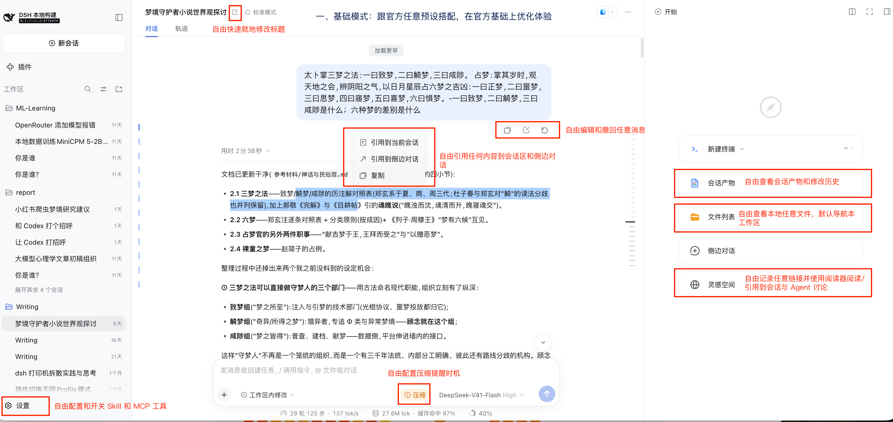

# dsh-plugins

[English](README.en.md) | 中文

**dsh**(DeepSeek Harness)生态的社区插件 monorepo:**三十多个纯增量插件包,组成 7 个套件**。所有包只走官方扩展点(slots、commands、Remote 服务、会话投影)接入——不修改任何官方包、不替换官方 UI 槽位、不 hack 核心服务;探测不到可选能力时静默降级,绝不拖垮启动。整套插件按共存设计:任意组合安装、卸载、开关,互不干扰,生产环境长期全量叠装运行。

## 套件:七种开箱体验

推荐的安装单元是**套件**(一个 npm 包),不是单包:套件用 npm 依赖装齐成员、用自带 patch 逐字挂载成员行;除基础体验外,每个套件还内联交付一个按会话授予的 agent preset——装上套件,就装上这个模式。

| 套件 | 包名 | 包含什么 | 门面仓 |
| --- | --- | --- | --- |
| **基础体验** | `@khorsheed/dsh-basic` | 12 个日常体验成员:消息编辑/撤回、历史时间轴、标题编辑、引用、产物预览、本地文件、任务胶囊、压缩提醒、内联卡片、能力目录、提示音、移动端 | [Khorsheed/dsh-basic](https://github.com/Khorsheed/dsh-basic) |
| **开发套件** | `@khorsheed/dsh-dev-suite` | 本地编码 agent 委派(Kimi / Codex / Claude Code / DSH)、worktree 改动实况、room 多 agent 协作、typesafe 快速决策、上下文透镜、运维守护,自带「开发模式」preset | [Khorsheed/dsh-dev](https://github.com/Khorsheed/dsh-dev) |
| **写作套件** | `@khorsheed/dsh-writing-suite` | 灵感画布、长篇小说体裁、灵感空间(RSS/链接阅读)、本机转写、渲染抓取,自带「写作模式」preset | [Khorsheed/dsh-writing](https://github.com/Khorsheed/dsh-writing) |
| **学习套件** | `@khorsheed/dsh-learning-suite` | 图书馆:按项目组织的精读学习(书籍摄入、路线图、讲义、测验判题),含画布/灵感空间/转写/渲染抓取,自带「学习模式」preset | [Khorsheed/dsh-learning](https://github.com/Khorsheed/dsh-learning) |
| **剪辑套件** | `@khorsheed/dsh-video-suite` | 剪辑台:混录自动分人、声纹认人、删字即删音频,导出音频/视频/字幕/shownotes;含本机转写与多 agent 协作(本地 agent 委派、协作间),自带「剪辑模式」preset | [Khorsheed/dsh-video](https://github.com/Khorsheed/dsh-video) |
| **游戏开发套件** | `@khorsheed/dsh-gamedev-suite` | 和 agent 一起做小游戏:试玩调参、外观编辑、分章节策划、版本与回滚,每轮结束自动检查,含多 agent 协作(本地 agent 委派、协作间),自带「游戏开发模式」preset | [Khorsheed/dsh-gamedev](https://github.com/Khorsheed/dsh-gamedev) |
| **评测套件** | `@khorsheed/dsh-eval-suite` | 本机 harness 对照评测:题集、任务规划、实验单元、执行与判分,含 local-agent 委派家族,自带「评测模式」preset | [Khorsheed/dsh-eval](https://github.com/Khorsheed/dsh-eval) |




## 能力地图

每个包的功能详情、配置与截图见各自目录的 README(点目录进包即达)。「安装包名」列复制即可装;「随套件」一列表示它随哪个套件装好(成员可在套件间重叠);标「单包」的不随任何套件,用「添加插件」对话框或 `dsh plugin add` 单独安装。

### 对话控制

| 包 | 插件能力 | 安装包名 | 宿主要求 | 随套件 |
| --- | --- | --- | --- | --- |
| [`message-tools`](packages/message-tools) | 用户消息**原位编辑 / 真撤回 / 恢复重放**——全家桶里唯一改变模型所见的插件,用的是与官方 compaction 同一套机制 | `@khorsheed/dsh-client-message-tools` | ≥ 0.1.5-rc.1 | basic |
| [`message-timeline`](packages/message-timeline) | 会话左缘悬浮**历史消息时间轴**,点击跳转任意用户消息 | `@khorsheed/dsh-message-timeline` | ≥ 0.1.2-rc.1 | basic |
| [`session-title-edit`](packages/session-title-edit) | 聊天区标题**内联重命名**,用户改过的标题不再被自动生成覆盖 | `@khorsheed/dsh-client-session-title-edit` | ≥ 0.1.2-rc.1 | basic |
| [`quote`](packages/quote) | 选中任意文本浮出**引用动作菜单**(引用进 composer / 侧边对话 / 复制),其他插件可注册自己的动作 | `@khorsheed/dsh-quote` | ≥ 0.1.5-rc.1 | basic |

### 文件与产物

| 包 | 插件能力 | 安装包名 | 宿主要求 | 随套件 |
| --- | --- | --- | --- | --- |
| [`file-preview`](packages/file-preview) | 会话「**产物**」tab + 宿主服务一体:产物 tab、回合变更卡片、详情页预览抽屉,与只读文件预览 Remote 服务同包 | `@khorsheed/dsh-file-preview` | ≥ 0.1.5-rc.1 | basic |
| [`local-files`](packages/local-files) | 右栏**本地文件浏览器**:懒加载文件树 + HTML/Markdown/JSON/CSV/图片结构化预览 | `@khorsheed/dsh-local-files` | ≥ 0.1.5-rc.1 | basic |

### 任务与氛围

| 包 | 插件能力 | 安装包名 | 宿主要求 | 随套件 |
| --- | --- | --- | --- | --- |
| [`taskpilot`](packages/taskpilot) | 聊天框上方**后台任务 / 子 Agent 胶囊**:运行计时、停止/中断、详情抽屉回放执行轨迹 | `@khorsheed/dsh-taskpilot` | ≥ 0.1.5-rc.1 | basic |
| [`context-guard`](packages/context-guard) | 上下文占用越过可配阈值时,聊天框上出现**一键 compact 提醒** | `@khorsheed/dsh-context-guard` | ≥ 0.1.2-rc.1 | basic |
| [`whalesong`](packages/whalesong) | 任务氛围:鲸鱼喷水、favicon 动画、完成/阻塞提示音(`prefers-reduced-motion` 自动静音) | `@khorsheed/dsh-whalesong` | ≥ 0.1.2-rc.1 | basic |

### 体验与效率

| 包 | 插件能力 | 安装包名 | 宿主要求 | 随套件 |
| --- | --- | --- | --- | --- |
| [`inline-html-render`](packages/inline-html-render) | 把 agent 写的 ```` ```dsh-card ```` HTML 渲染成会话内**沙箱交互卡片** | `@khorsheed/dsh-inline-html-render` | ≥ 0.1.2-rc.1 | basic |
| [`context-lens`](packages/context-lens) | **上下文透镜**:按 turn 查看每次模型请求的完整组成——system 分段归因、工具定义、历史与新增上下文、token 与耗时 | `@khorsheed/dsh-context-lens` | ≥ 0.1.5-rc.1 | dev |
| [`mobile`](packages/mobile) | **移动端呈现**与 iOS 桥 | `@khorsheed/dsh-mobile` | ≥ 0.1.5-rc.1 | basic |

### 写作与灵感

| 包 | 插件能力 | 安装包名 | 宿主要求 | 随套件 |
| --- | --- | --- | --- | --- |
| [`canvas`](packages/canvas) | **灵感画布**:在主题画布上积累卡片、连线与模型提议 | `@khorsheed/dsh-canvas` | ≥ 0.1.5-rc.1 | writing / learning |
| [`canvas-novel`](packages/canvas-novel) | 画布的「**长篇小说**」体裁:人物/伏笔/章节的作品记忆引擎、对账闸门与写作工具 | `@khorsheed/dsh-canvas-novel` | ≥ 0.2.0-rc.2 | writing |
| [`dsh-reader`](packages/dsh-reader) | **灵感空间**:RSS/Atom 订阅 + 粘贴文章链接,卡片流 + 可读详情视图 | `@khorsheed/dsh-reader` | ≥ 0.1.5-rc.1 | writing / learning |

### 学习

| 包 | 插件能力 | 安装包名 | 宿主要求 | 随套件 |
| --- | --- | --- | --- | --- |
| [`library`](packages/library) | **图书馆**:按项目组织的精读学习——书籍摄入、路线图、词书与测验判题 | `@khorsheed/dsh-library` | ≥ 0.1.7-rc.1 | learning |

### 剪辑与转写

| 包 | 插件能力 | 安装包名 | 宿主要求 | 随套件 |
| --- | --- | --- | --- | --- |
| [`video-studio`](packages/video-studio) | 右栏**剪辑台**:播客/对谈混录自动分人、节目声纹认人、删字即删音频,导出音频/视频/字幕 | `@khorsheed/dsh-video-studio` | ≥ 0.1.5-rc.1 | video |
| [`transcribe`](packages/transcribe) | **本机转写**:把长录音转成带时间的文字,可区分说话人;供剪辑、写作、学习套件调用 | `@khorsheed/dsh-transcribe` | ≥ 0.1.5-rc.1 | writing / learning / video |

### 游戏开发

| 包 | 插件能力 | 安装包名 | 宿主要求 | 随套件 |
| --- | --- | --- | --- | --- |
| [`game`](packages/game) | **游戏开发**操作台:和 agent 一起做小游戏——试玩调参、外观编辑、分章节策划、版本与回滚,每轮结束自动检查 | `@khorsheed/dsh-game` | ≥ 0.2.0-rc.1 | gamedev |

### 开发协作

| 包 | 插件能力 | 安装包名 | 宿主要求 | 随套件 |
| --- | --- | --- | --- | --- |
| [`worktrees`](packages/worktrees) | 会话头部 **repo/worktree 徽标** + 改动抽屉:待提交/已提交文件树、diff、提交记录;模型工具经包内 `./tool` 组合入口由 preset 按会话授予 | `@khorsheed/dsh-worktrees` | ≥ 0.1.5-rc.1 | dev |
| [`room`](packages/room) | **room 会话**:邀请多个 agent 进同一条会话——成员名册、@ 派发、任务板、通知闸门;模型工具经包内 `./tool` 组合入口由 preset 按会话授予 | `@khorsheed/dsh-room` | ≥ 0.1.5-rc.1 | dev / gamedev / video |

### 本地多 Agent

把子任务委派给你本机装的编码 Agent CLI,各自独立上下文、独立记账、跨轮续聊;每个 harness 在自己独立的作用域 home 下运行(`$DSH_HOME/local-agent/<name>`,0700),**绝不触碰你用户目录里的私人配置与凭据**。

与官方版本的差异:支持开发者指定主 Agent 邀请自定义的任意 Harness 完成目标任务——开发者可以根据自己的使用体感编排,比如建议主 Agent 在目标任务中邀请 Kimi 做前端任务,邀请 Codex / Claude Code 做整体任务编排,邀请 DSH 做具体的编码任务等等。

| 包 | 插件能力 | 安装包名 | 宿主要求 | 随套件 |
| --- | --- | --- | --- | --- |
| [`local-agent`](packages/local-agent) | 家族**核心**:harness 注册表、作用域目录供给、`/<harness> login|sessions|status|logout` 命令族 | `@khorsheed/dsh-local-agent` | ≥ 0.1.5-rc.1 | dev / eval / gamedev / video |
| [`local-agent-kimi`](packages/local-agent-kimi) | **Kimi Code** harness:`kimi -p` 委派、续聊、记账 | `@khorsheed/dsh-local-agent-kimi` | ≥ 0.1.5-rc.1 | dev / eval / gamedev / video |
| [`local-agent-codex`](packages/local-agent-codex) | **Codex** harness:`codex exec` 委派、续聊、记账 | `@khorsheed/dsh-local-agent-codex` | ≥ 0.1.5-rc.1 | dev / eval / gamedev / video |
| [`local-agent-claude-code`](packages/local-agent-claude-code) | **Claude Code** harness:`claude -p` 委派、续聊、记账 | `@khorsheed/dsh-local-agent-claude-code` | ≥ 0.1.5-rc.1 | dev / eval / gamedev / video |
| [`local-agent-dsh`](packages/local-agent-dsh) | **dsh 自委派** harness:把 dsh 自己当本地 CLI 用 | `@khorsheed/dsh-local-agent-dsh` | ≥ 0.1.5-rc.1 | dev / eval / gamedev / video |
| [`local-agent-dsh-headless`](packages/local-agent-dsh-headless) | (组合组件)dsh 委派的 **headless 子 profile** patch | `@khorsheed/dsh-local-agent-dsh-headless` | ≥ 0.1.5-rc.1 | 随 provider |

> 家族随开发套件与评测套件同装;单装是高级路径——核心与 provider 要显式一起装(核心缺席时 provider 行 pending,不崩)。各 provider 的委派工具(`subagent_kimi` 等)是包内 `./tool` 组合入口,由 preset 按会话授予。

### 评测

| 包 | 插件能力 | 安装包名 | 宿主要求 | 随套件 |
| --- | --- | --- | --- | --- |
| [`datasets`](packages/datasets) | **数据集**:在 git 仓库中管理版本化数据集,按层管控可见性 | `@khorsheed/dsh-datasets` | ≥ 0.2.0-rc.2 | eval |
| [`mission`](packages/mission) | **任务规划**:任务与任务批次的状态机、计划依赖、重试与注解 | `@khorsheed/dsh-mission` | ≥ 0.2.0-rc.2 | eval |
| [`lab`](packages/lab) | **实验单元**:隔离、可重复实验单元的生命周期管理 | `@khorsheed/dsh-lab` | ≥ 0.2.0-rc.2 | eval |
| [`eval`](packages/eval) | **评测**:校验评测计划,编排委派、判定并生成报告 | `@khorsheed/dsh-eval` | ≥ 0.2.0-rc.2 | eval |

### 能力与基础设施

| 包 | 插件能力 | 安装包名 | 宿主要求 | 随套件 |
| --- | --- | --- | --- | --- |
| [`capability-catalog`](packages/capability-catalog) | **能力目录**:枚举运行实例的全部 skill 与工具及其注册渠道,设置页三列预览 + 详情弹窗 | `@khorsheed/dsh-capability-catalog` | ≥ 0.1.5-rc.1 | basic |
| [`typesafe`](packages/typesafe) | (实验性)**TypeSafe 判定原语**宿主服务:接入 TypeSafe System One 模型支持模型快速决策场景调用,类型化 noul/choice/score 判定,带熔断、缓存与决策日志;模型工具经包内 `./tool` 组合入口由 preset 按会话授予 | `@khorsheed/dsh-typesafe` | ≥ 0.1.5-rc.1 | dev |
| [`capture`](packages/capture) | **渲染抓取** Remote:托管 headless Chrome 渲染 URL,返回内联样式的序列化页面 | `@khorsheed/dsh-capture` | ≥ 0.1.5-rc.1 | writing / learning |

### 运维守护

| 包 | 插件能力 | 安装包名 | 宿主要求 | 随套件 |
| --- | --- | --- | --- | --- |
| [`ankh-guard`](packages/ankh-guard) | 自修改重启的**安全门禁**:绿色凭证(绑定 git HEAD)+ 组合 preflight + watchdog 回滚——让 AI 自己改代码、自己重启,还不把服务搞挂 | `@khorsheed/dsh-ankh-guard` | ≥ 0.1.5-rc.1 | dev |

## Agent preset 设计

模式套件不只装插件,还内联交付**按会话授予的 agent preset**。三条设计规则:

1. **工具按会话授予。** 模型工具行不进 profile 根:每个工具面拆成 core(全局服务/UI)+ 包内伴生 `./tool` / `./agent` 组合入口;preset 组合按名引用伴生行——会话选中这个 preset 才拿到这组工具,其它会话的工具面保持干净。伴生 core 缺席时该行 pending,不炸宿主。
2. **UI 随授权自隐。** 会话绑定内容的面(会话 tab、头部徽标)跟随 preset 授予显隐——没被授予的会话根本看不到入口;跨会话的部署面不设运行时开关,装不装由安装决定。完整规范见 [docs/plugin-visibility.md](docs/plugin-visibility.md)。
3. **纯增量声明。** preset 以官方「标准模式」组合为底逐字重基,只在末尾追加社区工具行,不改任何官方行。

六个模式 preset 各随其套件交付(开发 / 写作 / 学习 / 剪辑 / 游戏开发 / 评测,见上表);基础体验不带 preset——日常不需要换模式。

## 模型影响总表

| 插件 | 模型上下文 | Token | KV 缓存 |
| --- | --- | --- | --- |
| message-tools(编辑/撤回) | 有——surface 替换遮蔽区间 | 移除区间 token,新增少量占位 | 前缀从替换点失效(同官方 compaction) |
| message-tools(恢复) | 有——尾部重放 | 新增可重放 token | 仅尾部延展,不改写 |
| local-agent 委派(子会话) | 独立子上下文 | 子会话独立付费,不进父级 | 与父级相互独立 |
| 其余全部插件 | 无 | 无 | 无 |

<a id="install-dev-guide"></a>
<details>
<summary><b>给 Agent 的安装及开发指南</b>(套件安装、单包安装、卸载、在本仓开发插件——点击展开)</summary>

### 安装

前置:dsh 宿主(各包的版本要求见能力地图各表的「宿主要求」列与包 README 的 Compatibility 节)。**推荐路径是套件**(见上文[套件](#套件七种开箱体验));单包安装是按需裁剪或调试的高级路径。

```sh
# 套件(推荐):一包装齐一个模式
dsh plugin --profile web add @khorsheed/dsh-basic        # 或 dsh-dev / dsh-writing / dsh-learning / dsh-video / dsh-gamedev / dsh-bundle-eval

# 单包(自挂载包自动挂载自身 loader 行,无需手改 cordis.yml)
dsh plugin --profile web add @khorsheed/dsh-whalesong

# local-agent 家族单装时注意:核心与 harness 要显式一起装
dsh plugin --profile web add @khorsheed/dsh-local-agent
dsh plugin --profile web add @khorsheed/dsh-local-agent-kimi   # 或 -codex / -claude-code / -dsh
```

宿主 ≥ 0.1.7-rc.2 时也可以不用碰命令行:**设置 → 插件 → 添加插件**,填 npm 包名,按提示启用/重启即可。注意这个入口只认**单个插件包**——本仓是 monorepo,把它的 GitHub 地址贴进去会被拒绝并回滚(官方安装器只装仓库根的插件包,不支持子目录)。发版当天请带版本下限(如 `@khorsheed/dsh-basic@^0.1.0`):pnpm 默认启用 24 小时新版保护,裸名会把当天发布的新版藏起来。

装完重启对应 web 实例生效。组合组件包(`local-agent-dsh-headless`、`ui-content-preview` 等)不由 `dsh plugin add` 挂载——它们由套件的 patch 或 provider patch 落位,完整关系见[权威包地图](docs/packages.md)。

### 卸载

```sh
dsh plugin --profile web remove @khorsheed/dsh-<name>
```

通用规则:

- **卸载即精确还原。** 没有任何插件修改/替换官方文件,移除后组合精确回到之前的状态。
- **用户数据刻意保留。** local-agent 家族保留每个 harness 的作用域目录(`$DSH_HOME/local-agent/<name>`),重装无需重新登录;ankh-guard 保留 `stateDir` 下的状态(凭证、重启记录、中断会话快照)。任何卸载都不碰会话日志——编辑/撤回的审计轨迹留在日志里是有意为之。
- **家族行随行。** 先卸 local-agent 核心而 harness 还在时,harness 行保持 **pending,不会崩溃**——重装核心即恢复。
- **`enabled: false`** 可以禁用某行而不卸载——这是部署层操作,不是代码改动。

### 开发

独立 pnpm monorepo;每个包以 `@khorsheed/dsh-*` 发布。

```
packages/   一个目录一个可发布插件或套件
profiles/   套件门面仓的同步源(basic / dev / eval / writing / learning / video / gamedev)
build/      共享构建/测试预设(tsdown client bundle、vitest 源码面配置)
scripts/    仓库工具(pack-dist、gen-typert、镜像同步、门禁检查器)
```

```sh
pnpm install
pnpm run build      # pnpm -r --if-present run build
pnpm run test       # pnpm -r --if-present run test
pnpm run typecheck  # pnpm -r --if-present run typecheck
```

测试必须走根 `pnpm test` 或 `pnpm --filter <pkg> test`——裸跑 `vitest run packages/xxx` 会绕过每包的 vitest 配置(源码面别名预设),报误导性的解析错误。

**开发期对 harness checkout 的依赖。** 两条机制解析到本地 deepseek-harness clone(env `DSH_HARNESS`,默认 `~/code/deepseek-harness`),发布的 npm 产物单独无法满足:

- `scripts/gen-typert.mts` 对 harness checkout 重新生成 `lib/typert.*` 产物(带 `./typert`/`./remote` 导出的包);全量构建有保鲜缓存,输入或产物有变才会真生成(`GEN_TYPERT_FORCE=1` 强制)。
- `build/vitest.ts`(共享 vitest 预设)把平台 import 映射到 harness 的 `tsconfig.base.json` 路径——发布的包不携带 `src/`,其 `/client` 入口是 loader 包裹的浏览器 bundle,裸 import 会炸。

CI 注意:先在本仓库旁 clone deepseek-harness 并设 `DSH_HARNESS` 再 `pnpm test`;harness checkout 过期意味着被测 API 面可能落后于生产宿主。发布走 `scripts/pack-dist.ts`(`--family` 重写 peer 依赖的 scope),`npm publish` 前先验证 tarball。完整仓库纪律见 [AGENTS.md](AGENTS.md)。

</details>
