# dsh-dev

English | [中文](README.md)

**Everything for writing code in DSH: direct a team of agents, and see exactly what they changed.** Hand work to the Kimi, Codex or Claude Code on your own machine, or to another DSH, in one sentence — watch it live, stop it midway, keep the conversation going; invite several agents into one session to split a job, @ whoever should take it, and acceptance stays your call; the session header shows the current branch and how many lines changed, one click away from pending changes and commit history; yes/no and pick-one calls come back as answers with a confidence attached; when the agent wants to restart after changing code, the build and tests have to pass first, and a version that won't boot is rolled back automatically; open any turn to see what the model actually received and where the tokens and time went…… The layer you want most when writing code, with "开发模式" (dev mode) built in, installed in one go.

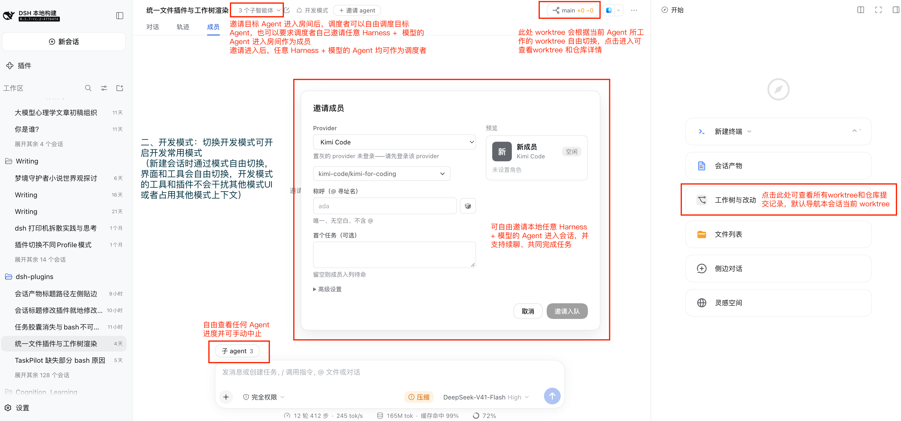

## Install

In DSH, open Plugins → Add plugin, enter this package name, and press Install:

```
@khorsheed/dsh-dev-suite
```

That installs all 10 members below; restart DSH and they're ready. It's best installed together with `@khorsheed/dsh-basic` (Basic Essentials), which carries everyday things like editing messages and previewing files.

Then start a new session, pick "开发模式" (dev mode), and tell the agent what you want to build. All of this only shows up in dev-mode sessions, so not seeing it in other modes is expected; everything from the standard mode — planning, compaction, sub-agents, web search — is still there.

Before you start: Kimi, Codex and Claude Code have to be installed by you; this suite doesn't do it. TypeSafe needs a TypeSafe key. Ankh Guard only works on an instance supervised by a watchdog.

## Things you can say to the agent

- "Hand this parser bug to Codex, and tell me which files it changed."
- "Make a new worktree for the login page refactor and work there; leave main alone."
- "Bring in Claude Code and Kimi: Claude Code writes it, Kimi adds tests, you coordinate, and show me the evidence."
- "Which worktrees does this repo have, and which ones have uncommitted changes?"
- "Restart the service when you're done — run the build and tests first."
- "Why was that turn so slow? Check with the context lens where the time went."

## Plugin list

| Plugin | Package name (copy to install) | What you get |
|---|---|---|
| local-agent | `@khorsheed/dsh-local-agent` | The base for local-agent delegation: a "Local Agent Delegation" card in settings for each tool's sign-in, model and always-on switch; the four below need it |
| local-agent-kimi | `@khorsheed/dsh-local-agent-kimi` | Hand work to Kimi Code on your machine, watch it live, keep the conversation going |
| local-agent-codex | `@khorsheed/dsh-local-agent-codex` | Hand work to Codex on your machine, watch it live, keep the conversation going |
| local-agent-claude-code | `@khorsheed/dsh-local-agent-claude-code` | Hand work to Claude Code on your machine, watch it live, keep the conversation going |
| local-agent-dsh | `@khorsheed/dsh-local-agent-dsh` | Hand a subtask to a separate DSH running on its own; off by default, turn it on in settings |
| worktrees | `@khorsheed/dsh-worktrees` | The branch and changed lines in the session header; open it for pending changes, commit history and repo files |
| room | `@khorsheed/dsh-room` | Invite several agents into one session, @ whoever takes the work, acceptance is yours |
| typesafe | `@khorsheed/dsh-typesafe` | Yes/no and pick-one calls come back as answers with a confidence attached |
| ankh-guard | `@khorsheed/dsh-ankh-guard` | Before the agent restarts the service, build and tests must pass; a version that won't boot is rolled back |
| context-lens | `@khorsheed/dsh-context-lens` | Click any turn to see what the model received and where the tokens and time went |

## Feature tour

### Local agent delegation: Kimi, Codex, Claude Code and DSH

Getting your local Codex or Claude Code to help used to mean opening a terminal, copy-pasting, and carrying the result back. Now you say "give this to Codex" and it runs on your machine: its thinking, tool calls and the files it touches stream into a sub-session, you can stop it midway, or open the sub-session and keep talking to it; the result comes back to your main session with real usage and timing. Each tool runs in its own separate directory, so your existing setup and sign-ins on this machine are never touched. The "Local Agent Delegation" card in settings shows at a glance whether each one is signed in, and it's where you switch the default model and always-on mode. "Local DSH Delegation" is off by default; turn it on when you want to hand subtasks to another DSH.

<details open>
<summary>Screenshots (5)</summary>

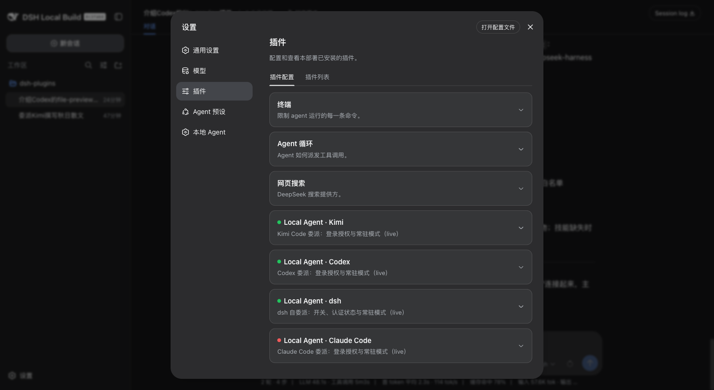

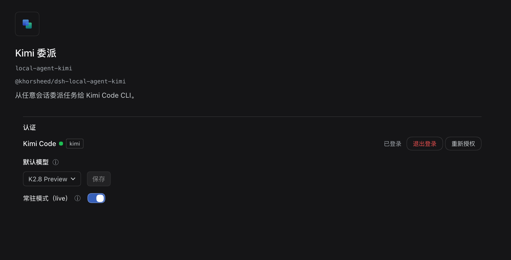

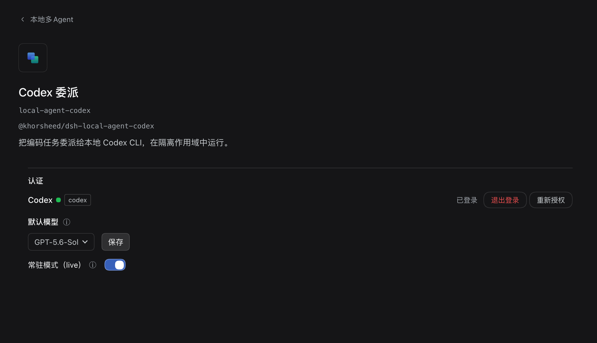

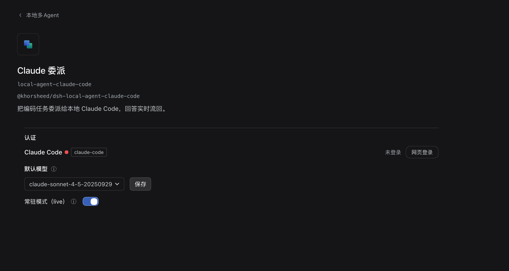

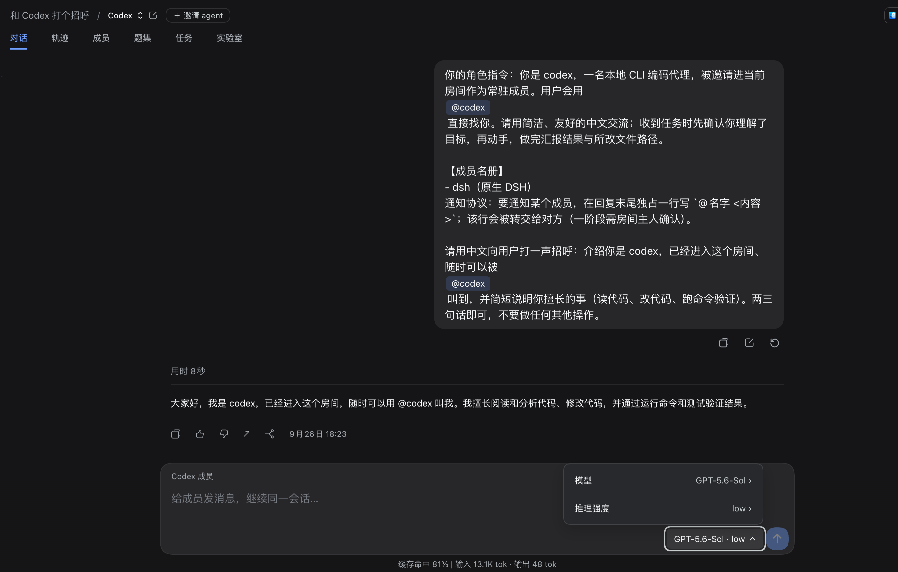

</details>

### room: a room for several agents

Getting several agents onto one job used to mean copy-pasting between windows. Now press "＋ Invite agent" in a session and it becomes a small team: DSH coordinates, and you bring in Kimi, Codex, Claude Code, or a DSH set up with another mode. @ a name at the start to hand that member the work, @ several to run them in parallel; the coordinator splits tasks and members hand in evidence — finishing isn't passing, and acceptance is up to you. A capsule above the input box tells you how many tasks are running and how many need you; open it to see who handed what to whom and how long each took, and the "Team" button on the members page draws how you, the coordinator and the members connect. Every member keeps its own session across turns and restarts.

<details open>
<summary>Screenshots (3)</summary>

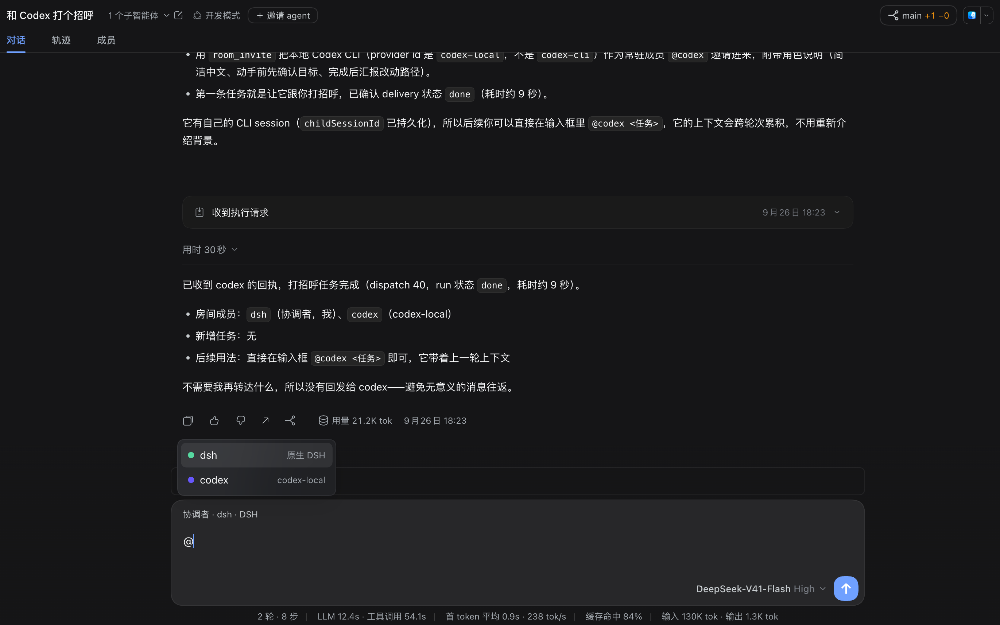

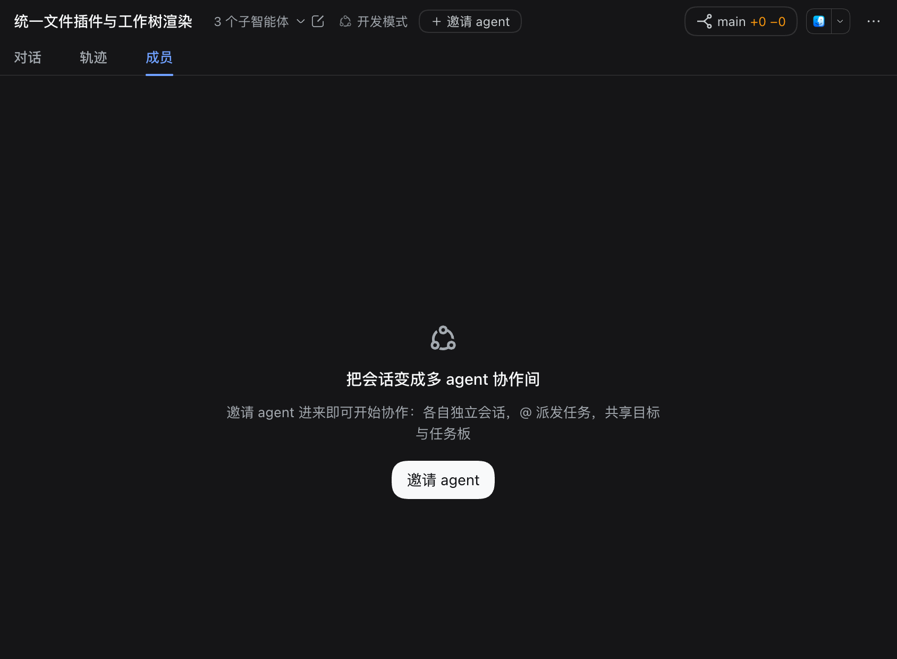

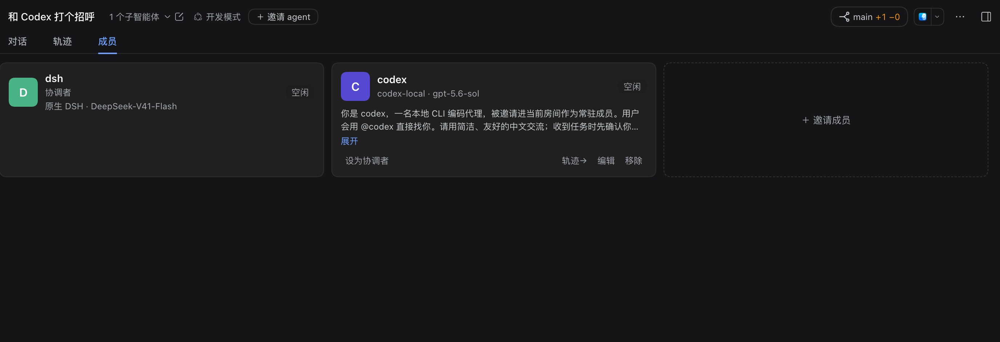

</details>

### worktrees: branch and changes at a glance

With a few worktrees open, you used to run git just to know which branch this session was on and how much was uncommitted. Now a branch badge sits in the session header with the branch name and changed lines, switching to a warning color when there are changes. Click it for the worktrees page in the right sidebar: pending changes with colored diffs, an IDE-style commit history you can expand one commit at a time, and the repo's files to browse, images previewed inline. All of this only looks — it never touches your repo. The agent can also create, switch and remove worktrees; removal always asks you first, and one with uncommitted changes is never removed.

<details open>
<summary>Screenshots (2)</summary>

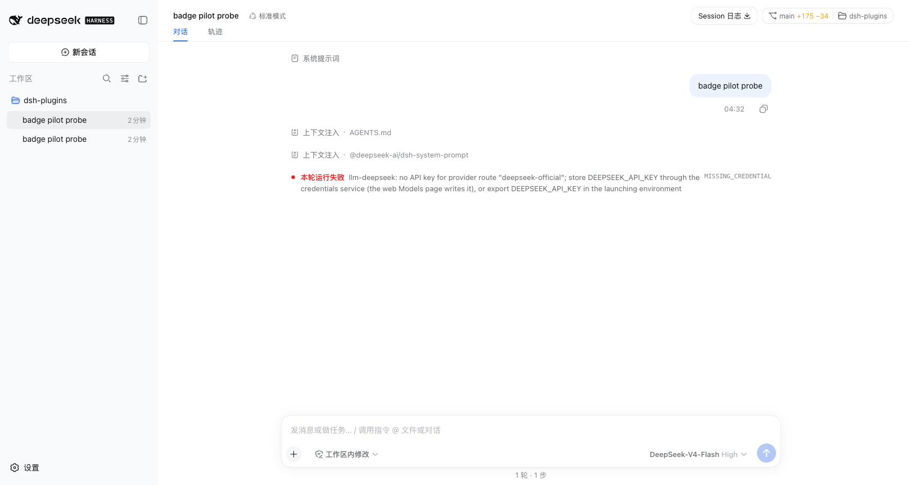

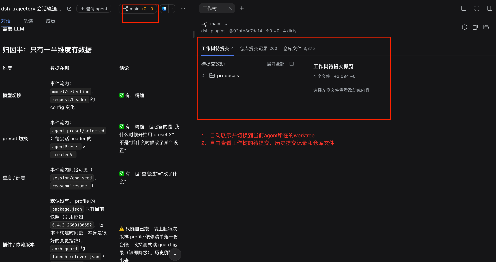

</details>

### typesafe: TypeSafe quick judgements

"Should the model handle this message?" "Which team does this ticket belong to?" — if the agent answers that kind of question with a paragraph, you end up reading it again. With TypeSafe, yes/no, pick-one and rate-it questions come back as answers with a confidence attached, so the agent can act on them directly; the room also uses it to decide when a member's report is best handed to the coordinator. Enter your TypeSafe key under "Tools & Skills" first; without one it simply reports that it can't answer, nothing breaks.

### ankh-guard: Ankh Guard

Letting the agent change DSH's own code is handy; the trouble is the restart. Break something and the service goes down along with the conversation you're in, leaving you to clean up. With Ankh Guard, the agent has to show the build and tests pass before it may restart; before the real stop, the new version is started once in the background, and if it won't come up the old one is left alone; if the new version keeps failing to boot, it rolls back to the last version that started cleanly, and if a newly installed plugin caused it, that plugin is removed and you're told which. After the restart, the session that asked for it gets the result, interrupted sessions carry on, and open pages refresh themselves back to where you were.

<details open>
<summary>Screenshots (1)</summary>

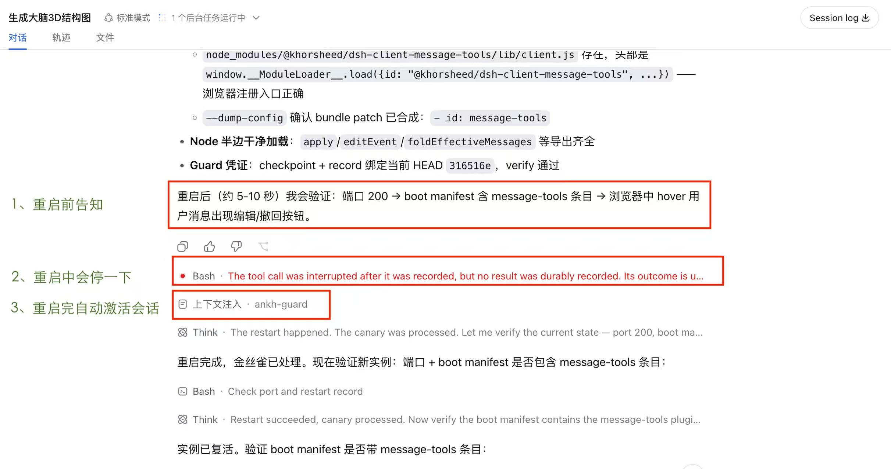

</details>

### context-lens: Context Lens

When you're tuning prompts or writing plugins, what you most want to know is: what was actually in this request? Why didn't the cache hit? Why was this turn so slow? Now every answer has a small icon under it; click it and the right sidebar lays out every model request in that turn: where each part of the system prompt came from, how many tools were attached, what is history and what's new this time; the real cache hits, with the differences from the previous request marked down to the character; "Duplicates only" picks out content stuffed in more than once; the "Timing" view shows whether the time went to the model, the tools or the gaps between. Delegated sub-agents are listed separately, and conversations from before you installed it can be inspected too. It only looks, never changes anything, and doesn't write what it sees into the session.

<details open>
<summary>Screenshots (2)</summary>


</details>

## Make it yours

- **Remove a member**: disable/uninstall in Settings → Plugins, or `dsh plugin --profile <your profile> remove <package name>` — the rest keep working. Don't use one of the local agents? Turn off just that one; `local-agent` is the base all four share, so turning it off stops them all. The suite is a starting point, not a lock-in.
- **Add more**: any `@khorsheed/dsh-*` plugin installs the same way — copy the package name.
- **Update**: from Settings → Plugins, or `dsh plugin --profile <your profile> update` to pull the newest versions in range.

## Other suites

The essentials are the layer everyone wants; add a suite for the scene you work in.

| Suite | Package | What it is |
|---|---|---|
| [Basic Essentials](https://github.com/Khorsheed/dsh-basic) | `@khorsheed/dsh-basic` | Edit and withdraw messages, the timeline, title editing, quoting, artifact preview, local files, task capsules, compaction reminders, inline cards, the capability catalog, completion chimes, mobile |
| [Writing Suite](https://github.com/Khorsheed/dsh-writing) | `@khorsheed/dsh-writing-suite` | The idea canvas, the novel genre, the reading space and local transcription — with "写作模式" (writing mode) |
| [Learning Suite](https://github.com/Khorsheed/dsh-learning) | `@khorsheed/dsh-learning-suite` | Library-style close reading, the idea canvas and the reading space — with "学习模式" (learning mode) |
| [Video Suite](https://github.com/Khorsheed/dsh-video) | `@khorsheed/dsh-video-suite` | A cutting room with speaker splitting and delete-the-word-deletes-the-audio, plus local-agent delegation — with "剪辑模式" (editing mode) |
| [Gamedev Suite](https://github.com/Khorsheed/dsh-gamedev) | `@khorsheed/dsh-gamedev-suite` | Build small games with the agent, plus local-agent delegation — with "游戏开发模式" (game dev mode) |
| [Eval Suite](https://github.com/Khorsheed/dsh-eval) | `@khorsheed/dsh-eval-suite` | Compare agents on this machine: question sets, experiments, judging and reports — with "评测模式" (eval mode) |
| [dsh-plugins](https://github.com/Khorsheed/dsh-plugins) | — | The plugin monorepo: the capability map of every package and the development docs |

## Compatibility

Needs DSH 0.1.7 or later; verified on 0.2.1.

## Changelog

See [CHANGELOG.md](CHANGELOG.md).

## Developing

Plugins live in [Khorsheed/dsh-plugins](https://github.com/Khorsheed/dsh-plugins) (single source of truth); each member's details are in its own README under [packages/](https://github.com/Khorsheed/dsh-plugins/tree/main/packages). This repo carries only the profile template, install scripts and docs, no plugin code; the suite itself is published as `@khorsheed/dsh-dev-suite`. Issues welcome.

## Install guide for agents

<details>
<summary><strong>Expand: whole-suite install + single-package CLI install</strong> (follow this when the user says "install this for me")</summary>

### 1. Installing the whole suite (recommended)

Recommended: install it together with the basic suite (the Dev collection, one command):

```sh
dsh plugin --profile web add @khorsheed/dsh-basic @khorsheed/dsh-dev-suite
```

Or Settings → Plugins → Add plugin, enter `@khorsheed/dsh-dev-suite`. Restart the web instance, then ask the user to **hard-refresh** (Cmd/Ctrl+Shift+R) — new interface code only loads on a hard refresh; a plain reload may keep serving the cached page. Then present the feature list (the plugin table above) and remind the user to start a new session in "开发模式" (dev mode).

Uninstalling the suite (`dsh plugin --profile web remove @khorsheed/dsh-dev-suite`) removes its members too; to turn off just one, switch it off on the suite's detail page.

### 2. Installing a single plugin

- **Dialog**: Settings → Plugins → Add plugin, enter the package name (e.g. `@khorsheed/dsh-worktrees`), enable as prompted.
- **CLI**: `dsh plugin --profile <profile> add <package name>`; `remove` to uninstall, `update` to upgrade.
- When installing a single local agent (e.g. `@khorsheed/dsh-local-agent-codex`), install `@khorsheed/dsh-local-agent` alongside it.

### 3. Hosts older than 0.1.7: directory install with this repo's scripts

Hosts before 0.1.7 can't install a mode suite by package name yet; use this repo's scripts instead (needs host ≥ `0.1.5-rc.1`; this installs an earlier set of members, without TypeSafe and Context Lens):

```sh
git clone https://github.com/Khorsheed/dsh-dev.git /tmp/dsh-dev
sh /tmp/dsh-dev/scripts/install.sh
sh /tmp/dsh-dev/scripts/restart-into-dev.sh [port, default 3080]
```

`install.sh` only places the profile template and never touches the running instance; the row count it prints at the end lets you double-check. If `dsh` isn't on PATH, use its full path (read it off the running instance's launch command with `ps`). `restart-into-dev.sh` stops the old instance and starts the new one on the same port through Ankh Guard's channel: **you'll be disconnected together with the host instance, and that's expected** — when the user reopens this session, you get a "restart complete" follow-up and carry on. Finally, ask the user to hard-refresh as well.

</details>
